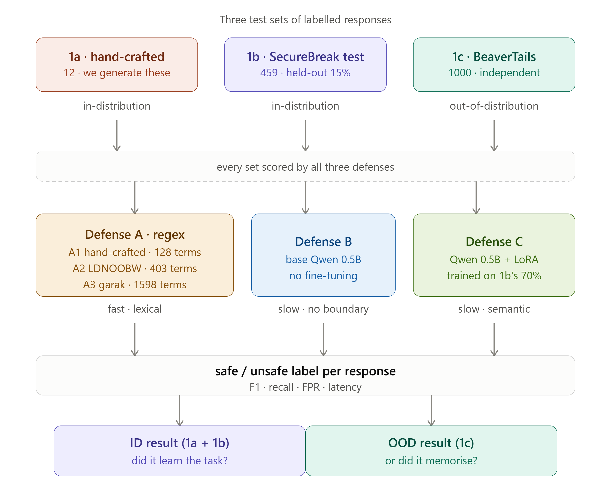
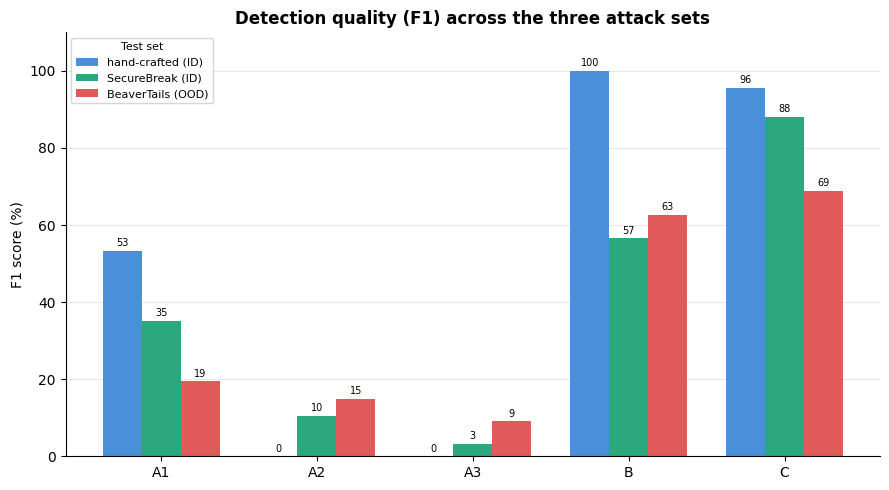
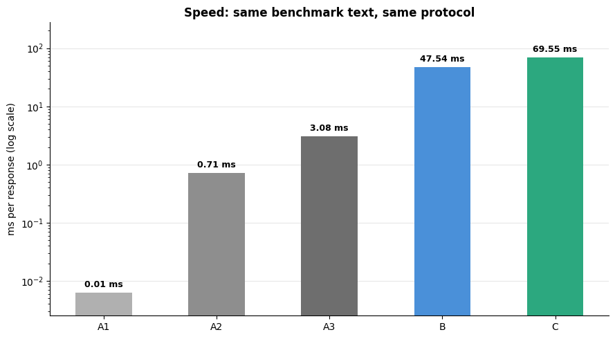

# LLM Guardrails: Regex Filters vs. a Fine-tuned Guard LLM

Project for the **Data Science & Cybersecurity** course at the **University of Pavia** (MSc Data Science, Year I, Semester II, Erasmus+ exchange). 

## The task

LLMs can be **jailbroken**: carefully disguised prompts trick them into producing harmful content. A **guardrail** is the last line of defense. It reads the model's response and blocks it if it is unsafe. The guardrail never sees the prompt.

**Question:** a keyword filter runs in microseconds and an LLM guard takes tens of milliseconds. Is the extra intelligence worth the cost, and does it generalize to data it has never seen?

## The solution

**Three defenses**, each labeling a response as safe or unsafe:

| Defense | What it is |
|---|---|
| **A – Regex filter** | Blocklists of 128 terms (hand-crafted), 403 terms (LDNOOBW) and 1,598 terms (NVIDIA garak) |
| **B – Base Qwen2.5-0.5B** | Same model as C, no safety training. Used as a baseline. |
| **C – Fine-tuned guard** | Qwen2.5-0.5B fine-tuned with **LoRA** (r=8, α=16) on the [SecureBreak](https://github.com/VIGNESH-KUMAR-KEMBU/SecureBreak) dataset, which has 3,059 human-labeled responses |

**Three test sets:**

| Set | Content | Distribution |
|---|---|---|
| **1a** | 12 hand-crafted jailbreaks (academic, fictional or professional disguise) answered by Qwen2.5-1.5B and labeled by hand | in-distribution |
| **1b** | 459 held-out SecureBreak responses (15%, never seen in training) | in-distribution |
| **1c** | 1,000 balanced responses from [BeaverTails](https://arxiv.org/abs/2307.04657), an independent safety dataset | **out-of-distribution** |

**Technical details:**
- **Logit-based classification:** the model's "safe" and "unsafe" token scores are compared directly. This is deterministic, needs no text generation and no output parsing.
- **Loss masking:** only the final answer token is trained on, so the whole training signal comes from the decision.
- **Fair latency benchmark:** the same text and the same protocol for every defense, with warm-up runs and GPU synchronization.

## Results

| Defense | F1 on SecureBreak (ID) | F1 on BeaverTails (OOD) | False positive rate on SecureBreak | Latency per response |
|---|---|---|---|---|
| A1 – Regex, 128 terms | 35.2 | 19.4 | 13.7% | 0.006 ms |
| A3 – Regex, 1,598 terms | 3.2 | 9.0 | 0.4% | 3.1 ms |
| B – Base Qwen 0.5B | 56.6 | 62.7 | 86.3% | 47.5 ms |
| **C – Fine-tuned guard** | **88.1** | **69.0** | **10.5%** | 69.5 ms |

- **Keyword filtering fails at the response level.** Even 1,598 terms catch only about 2% of harmful responses. Published blocklists target profanity, while jailbreak output is fluent and professional.
- **The dataset makes the guard, not the model.** With the same 0.5B architecture, the base model flags almost everything (86% false positives). After fine-tuning it reaches 88 F1, a gain of 31 points that comes purely from SecureBreak.
- **The learning partly generalizes.** The fine-tuned guard keeps 69 F1 on BeaverTails, which it never saw. The drop from 88 shows that some of what it learned is specific to SecureBreak.

## Authors

[Laura-Vanesa Lungu](https://github.com/LVanesa) & [Fuciuc Filip-Luca](https://github.com/filiplucafuciuc), University of Pavia.
